<div align="center">


<br/>



<br/><br/>

<a href="https://github.com/vanluan20112003"></a>


</div>


## `> about_me`

```js
const luan = {
  role:     "Fullstack Developer",
  focus:    ["Web Applications", "Data Platforms", "Linux Infrastructure"],
  building: "Digital tools for education",
  motto:    "Build it right. Keep it running. Make the data trustworthy.",
};
```


## `> tech_stack`

<div align="center">


</div>


## `> projects`

<table>
<tr>
<td width="50%" valign="top">

### 🏛️ University Data Platform
Data management and reporting for higher education.


</td>
<td width="50%" valign="top">

### 🎓 E-Learning Platforms
Online courses and interactive learning content.


</td>
</tr>
<tr>
<td width="50%" valign="top">

### 🛡️ Infrastructure & Security
Linux servers, monitoring and system reliability.


</td>
<td width="50%" valign="top">

### 🏡 Nhà Đất Luyện Phát
Real estate website.

<a href="https://github.com/vanluan20112003/NhaDatLuyenPhat"></a>

</td>
</tr>
</table>


## `> github_stats`

<div align="center">


</div>

<div align="center">

<br/>


</div>
