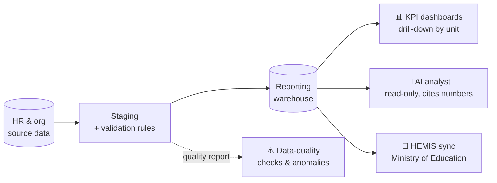

<div align="center">


<a href="https://github.com/vanluan20112003">
  
</a>

<p>
  <a href="https://github.com/vanluan20112003"></a>
  
  
</p>

</div>

```yaml
whoami:
  name: Le Van Luan
  role: Fullstack Developer · Data & Systems
  works_on:
    - University data platform (HR, students, reporting)   # HUFLIT DataSystem
    - National education data sync                         # HEMIS integration
    - Online learning infrastructure                       # Open edX · H5P
    - Endpoint monitoring & security                       # Wazuh
  stack_of_choice: [Python, Django, PHP, Laravel, React, Next.js, PostgreSQL, MySQL, Docker, Linux]
  believes: "A number on a dashboard is only as good as the pipeline behind it."
```

---

## ⚡ What I do

I build systems **end to end**: model the data, write the APIs, ship the UI, then run it on Linux servers and keep it observable.
Most of my work lives where **software meets institutional data**: messy source records, strict reporting rules, and leaders who need numbers they can trust.

<table>
<tr>
<td width="50%" valign="top">

**🧱 Build**
- Backend & REST APIs (Django, Laravel)
- Admin dashboards & reporting UIs (React)
- Data models, validation, integration contracts

</td>
<td width="50%" valign="top">

**📊 Data**
- Staging → warehouse → reporting layers
- Data-quality rules & anomaly checks
- AI-assisted analysis grounded in real queries

</td>
</tr>
<tr>
<td width="50%" valign="top">

**🐧 Run**
- Linux server administration
- Docker / Tutor deployments, Nginx
- Video pipelines (FFmpeg → HLS)

</td>
<td width="50%" valign="top">

**🛡️ Secure**
- Wazuh endpoint monitoring
- SSH activity & process tracing
- Role-based access & privacy-aware reporting

</td>
</tr>
</table>

---

## 🛠️ Tech Stack

<div align="center">

**Languages**<br/>


**Frameworks**<br/>


**Data & Infrastructure**<br/>


**Tooling & Observability**<br/>


<br/>


</div>

---

## 🚀 Featured Work

### 🏛️ HUFLIT DataSystem — University Data & Reporting Platform


A data platform for managing university personnel and organizational data, and turning it into reports leadership can act on.



- **Workforce dashboards**: headcount, qualifications, succession risk and productivity, with year-over-year trends and drill-down to each faculty.
- **Data-quality layer**: rule-based checks (missing unit, invalid birth dates, contract gaps) surfaced to users instead of silently skewing reports.
- **AI-assisted analysis**: an analyst that only reads the warehouse, writes findings with charts, and checks every number it states against the source data.
- **Privacy by design**: small-group suppression for sensitive breakdowns and access scoped by role.
- **HEMIS integration**: national education data sync using OAuth2 plus an XML digital-signature session, followed by JSON sync APIs.

`Django` `PostgreSQL` `React` `Data Warehouse` `ETL` `LLM` `System Integration`

---

### 🎓 MOOC VNU — Open edX Learning Platform


Development and operations for a university MOOC platform built on Open edX.

- Deploy and configure services with **Tutor** on Docker.
- Extend Django-based platform components and integrations for learning workflows.

`Python` `Django` `Open edX` `Tutor` `Docker` `Linux`

---

### 🛡️ Wazuh Endpoint Monitoring → EDR


Extending an existing Wazuh deployment toward EDR capabilities instead of buying a commercial product.

- Log analysis and predictive risk alerts for monitored endpoints.
- **SSH session visibility**: who logged in and what they did afterwards, traced through process relationships.
- Separate monitoring pipelines for SSH activity and high-volume web traffic.

`Wazuh` `Linux` `Log Correlation` `Security Automation`

---

### 🎬 H5P Video Infrastructure


Delivering video-based interactive learning content on constrained servers.

- Multi-resolution transcoding with **FFmpeg** and **HLS** adaptive streaming.
- Balancing concurrent encoding jobs against CPU and storage limits.

`WordPress` `H5P` `PHP` `FFmpeg` `HLS` `Linux`

---

### 🏡 Nhà Đất Luyện Phát — Real Estate Website
<a href="https://github.com/vanluan20112003/NhaDatLuyenPhat"></a>

A production website on a **$0 infrastructure budget**.

- Next.js static export, deployed to GitHub Pages through GitHub Actions.
- Supabase for Postgres, image storage and Edge Functions, with Row Level Security policies.

`Next.js` `Supabase` `PostgreSQL` `GitHub Actions`

---

## 📈 GitHub Activity

<div align="center">


</div>

---

## 🧭 Engineering Principles

```diff
+ Understand the domain before writing the schema.
+ Make data trustworthy: validate, trace, and show your sources.
+ Design for the next maintainer: clear boundaries, explicit contracts.
+ Measure, don't guess: test assumptions and monitor what you ship.
- Ship a dashboard nobody can explain.
```

## 🔭 Currently Leveling Up

| Area | Focus |
|---|---|
| **Data Engineering** | Staging layers, slowly changing dimensions, analytical models |
| **AI & Analytics** | Text-to-SQL, RAG, evidence-based reporting with LLMs |
| **DevOps** | Container orchestration, reverse proxies, centralized logging |
| **Quality** | API & end-to-end testing, secure development practices |

---

<div align="center">

### 🤝 Let's build something reliable

Interested in **data platforms**, **digital transformation in education**, and **infrastructure**? Let's connect.

<a href="https://github.com/vanluan20112003"></a>
<!-- Add more contact badges when ready, e.g.:
<a href="https://www.linkedin.com/in/YOUR-ID"></a>
<a href="mailto:YOUR-EMAIL"></a>
-->


</div>
