<div align="center">




</div>



### 🎧 now playing

<div align="center">

</div>


### 🎹 track 00 — intro

```js
// put on your headphones, this one's slow
const luan = {
  plays:  "code",
  genre:  ["web apps", "data platforms", "linux servers"],
  tempo:  "slow & steady",
  mood:   "chill",
  mantra: "every bug is just a note out of tune",
};
```


### 💿 tracklist

| | # | track | vibe | |
|:-:|:-:|---|---|:-:|
| ▶ | 01 | **University Data Platform** | data, reports & the stories numbers tell | `🟣 playing` |
| ▶ | 02 | **E-Learning Platforms** | online classes, interactive lessons | `🟣 playing` |
| ▶ | 03 | **Infrastructure & Security** | quiet servers, calm nights | `🟠 on repeat` |
| ▶ | 04 | **[Nhà Đất Luyện Phát](https://github.com/vanluan20112003/NhaDatLuyenPhat)** | a website on a $0 budget | `🟢 released` |


### 🎸 instruments

<div align="center">

</div>


### 📻 listening stats

<div align="center">


</div>


<div align="center">


<a href="https://github.com/vanluan20112003"></a>

</div>
