<div align="center">


</div>


### — now playing

<div align="center">

</div>


### — liner notes

> *Some people keep a diary. I keep a commit history.*
> *I like quiet servers, honest data, and code that still makes sense a year later.*

```js
const luan = {
  plays:  "code",
  genre:  ["web apps", "data platforms", "linux servers"],
  tempo:  "slow & steady",
  mantra: "every bug is just a note out of tune",
};
```


### — side A · tracklist

| no. | title | notes |
|:-:|---|---|
| 01 | **University Data Platform** | data, reports, and the stories numbers tell |
| 02 | **E-Learning Platforms** | online classes and interactive lessons |
| 03 | **Infrastructure & Security** | quiet servers, calm nights |
| 04 | **[Nhà Đất Luyện Phát](https://github.com/vanluan20112003/NhaDatLuyenPhat)** | a small website on a $0 budget |


### — instruments

<div align="center">

</div>


### — listening history

<div align="center">


</div>


<div align="center">


</div>
